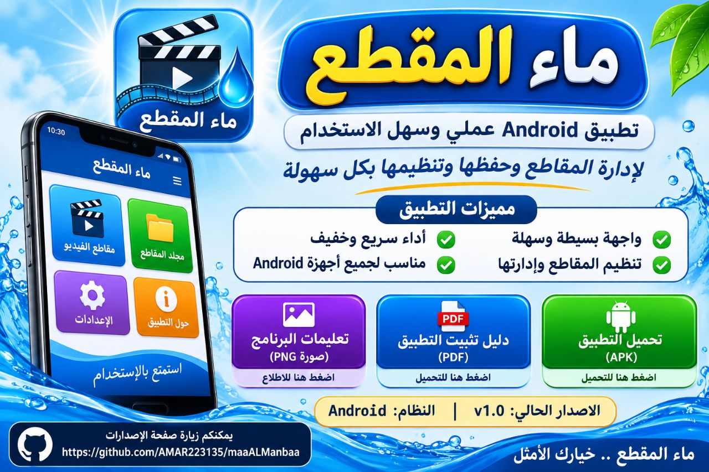

# 💧 ماء المقطع
مرحباً بكم في الصفحة الرسمية لتطبيق ماء المقطع.

تطبيق Android، يمكنكم تحميله والاطلاع على الأدلة والتعليمات من الروابط التالية.

---
## ⭐ مميزات التطبيق

- 🔄 حساب الدور القادم تلقائياً.
- 📅 معرفة موعد الدور القادم.
- 🔔 إرسال إشعار تنبيهي قبل 20 دقيقة من الوقت المحدد.
- ⏰ المساعدة على عدم نسيان موعد الدور.
## 📱 تحميل التطبيق
## 📖 شرح طريقة استخدام التطبيق

في الصورة التالية شرح لطريقة استخدام تطبيق ماء المقطع:

## 📖 شرح طريقة استخدام التطبيق

في الصورة التالية شرح لطريقة استخدام تطبيق ماء المقطع:

[⬇️ تحميل تطبيق ماء المقطع (APK)](https://github.com/AMAR223135/maaALManbaa/releases/download/maalmakta/app-release.apk)

## 📚 الأدلة والتعليمات

[📘 دليل تثبيت التطبيق (PDF)](https://github.com/AMAR223135/maaALManbaa/releases/download/maalmakta/default.pdf)

## 🖼️ تعليمات البرنامج

---

## 📦 معلومات الإصدار

- الإصدار: v1.0
- النظام: Android

[زيارة صفحة الإصدارات](https://github.com/AMAR223135/maaALManbaa/releases/tag/maalmakta)

---

ماء المقطع – الإصدار الرسمي
